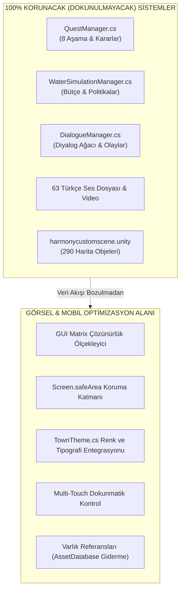

# HARMONY TOWN (DENGE KASABASI) — UNITY MOBILE GAME PROJECT AUDIT
**Doküman Kodu:** `DOC-HT-AUDIT-001`  
**Tarih:** 12 Ekim 2026  
**Unity Sürümü:** Unity 6 (`6000.6.4f1`)  
**Render Pipeline:** Universal Render Pipeline (URP 17.6.0 - 2D Renderer)  
**Değerlendirme Kapsamı:** Mobil Görsel Denetim, Sanat Yönetimi, UI/UX ve Teknik Uyumluluk  

---

## 1. YÖNETİCİ ÖZETİ & PROJE DURUMU

**Harmony Town (Denge Kasabası)**, Atlas Learning ekosisteminin merkezinde yer alan, çevre bilinci, su yönetimi ve belediye ölçeğinde karar alma mekanizmalarını çocuklara ve gençlere öğreten **tam fonksiyonel, zengin içerikli bir 2D macera ve simülasyon oyunudur**.

### Doğrulanan Güçlü Yönler (Korunacak Sistemler)
1. **Zengin Anlatı ve Görev Mimarisi:** 8 aşamalı tam döngü (`IntroLina` -> `MeetMayor` -> `InvestigateTown` -> `ReportToMayor` -> `Expectation` -> `TimeShiftMid` -> `TimeShiftEnd` -> `Finale`).
2. **4 Bölge ve Mini-Oyun Derinliği:** Baraj (Mühendis Aylin - Boru Akış Bulmacası), Konut/Çınar Cad. (Nuri Amca - Akustik Radar & Boru Onarımı), Park (İşçi Kemal - Akıllı Sulama & Fıskiye), Tarım Vadisi (Çiftçi Rıza - Damla Sulama Masası).
3. **Türkçe Seslendirme Prodüksiyonu:** 63 adet profesyonel Türkçe diyalog seslendirmesi (`Assets/Audio/Voices/`), 6 SFX efekti, 3 ortam ambiyans sesi.
4. **Görsel Roman & Sinematik Sahne Sunumu:** 16:9 geniş ekran diyalog sahneleri, tam boy ayakta duran karakter illüstrasyonları, panoramik arka planlar ve MP4 giriş introları.
5. **Web ve Bulut Entegrasyonu:** `AtlasBackendClient.cs` ve `AtlasDataModels.cs` ile okul kodu, öğrenci karnesi, TYMM büyük veri raporu ve mezuniyet sertifikası.

### Kritik Mobil Uyarılar (Mevcut Durum Kısıtları)
- Oyunun tüm UI mimarisi (~8.200 satır C#) **Unity IMGUI (`OnGUI()`)** üzerinde geliştirilmiştir.
- Arayüz pikselleri masaüstü/1080p sabit çözünürlüğe göre mutlak (absolute) koordinatlarla (`Rect`) yazılmıştır; DPI ölçekleme, `GUI.matrix` adaptasyonu ve `Screen.safeArea` desteği **bulunmamaktadır**.
- Runtime C# scriptlerinde yer alan `UnityEditor.AssetDatabase` ve `File.ReadAllBytes` çağrıları, mobil cihazda (Android/iOS standalone build) kritik derleme ve dosya erişim hatalarına (P0) yol açmaktadır.
- Dokunmatik kontroller tek-fare emülasyonuna dayalıdır; joystick ile aynı anda konuş butonuna basılması (multi-touch) çakışmaktadır.

---

## 2. UNITY TEKNİK ALTYAPISI & SAHNE ANALİZİ

### 2.1. Unity Versiyonu ve Render Pipeline
- **Unity Sürümü:** `6000.6.4f1` (Unity 6 LTS).
- **Render Pipeline:** URP 2D (`com.unity.render-pipelines.universal: 17.6.0`).
- **Pipeline Ayarları:** `Assets/Settings/UniversalRP.asset` ve `Assets/Settings/Renderer2D.asset`.
- **Renk Uzayı:** `m_ActiveColorSpace: 1` (**Linear Color Space** aktif).
- **Proje Çözünürlük Varsayılanı:** 1920x1080 (PC), 960x600 (Web).

### 2.2. Projedeki Sahneler
1. **`Assets/harmonycustomscene.unity` (1.080 KB - Aktif Ana Sahne):**
   - 290 adet hiyerarşik GameObject barındırır.
   - `HarmonyTownEditor.cs` tarafından üretilmiş en güncel sahnedir; Park & Bahçe mobilyaları, 4 bölge kriz/dönüşüm objeleri, çitler, vanalar ve aydınlatma direkleri bu sahnede eksiksiz yer almaktadır.
2. **`Assets/Scenes/HarmonyTown.unity` (782 KB):**
   - 204 GameObject barındıran temel sahne.
3. **`Assets/Scenes/SampleScene.unity` (9.7 KB):**
   - Şablon sahnesi (Build ayarlarında varsayılan olarak kalmış; düzeltilmeli).
4. **`Assets/_Recovery/0.unity` & `0 (1).unity` (783 KB):**
   - Otomatik yedekleme kurtarma sahneleri.

### 2.3. Kamera ve Görüntü Oranı Ayarları
- **Kamera Tipi:** 2D Orthographic Camera (`orthographic: 1`).
- **Orthographic Size:** `4.25`.
- **Arka Plan Rengi:** `{r: 0.125, g: 0.188, b: 0.121, a: 1}` (Doğal koyu orman yeşili).
- **Kamera Takibi:** `CameraFollow2D.cs` (`smoothSpeed = 8.0f`, `offset = (0, 0, -10)`).
- **Görüntü Oranı:** 16:9 baz alınmıştır; ancak mobil cihazlarda 19.5:9, 20:9 veya 4:3 (iPad) ekranlarda kamera sınırları dışı siyah boşluk veya açık kenarlar gösterebilir.

### 2.4. Katman ve Sıralama (Sorting & Depth)
- **TagManager:** Yalnızca tek bir Sorting Layer tanımlıdır: `Default`.
- **Derinlik Yönetimi:** `YSortOrder.cs` bileşeni ile Stardew Valley usulü dinamik Y ekseni derinliği sağlanır:
  $$\text{sortingOrder} = 10000 - \lfloor Y \times 100 \rfloor + \text{offset}$$
- Sabit nesneler için `isStatic = true` bayrağı mevcuttur; dinamik karakterler için `LateUpdate` tetiklenir.

---

## 3. ASSET ENVANTERİ VE KAYNAK DENETİMİ

| Asset Kategorisi | Adet | Format | Durum & İnceleme Notu |
|---|---|---|---|
| **Karakter Sprite'ları** | 47 | PNG | Lina (4 yön yürüme), Oyuncu (4 yön yürüme), Kasabalılar. Çözünürlük 32 PPU, net ve tutarlı. |
| **Bina Sprite'ları** | 10 | PNG | Belediye binası, dükkanlar, apartmanlar, okul. 2.5D izometrik-top-down tarzı. |
| **Doğa & Çevre** | 14 | PNG | Çam ağaçları, yuvarlak ağaçlar, çalılar, çiçeklikler, taşlar. |
| **Tarım & Su** | 18 | PNG | Çitler, seralar, havuç tarlası, rüzgar gülü, baraj duvarı, hendek, borular. |
| **Atölye & Mini-Oyun** | 43 | PNG | Boru fayansları, basınç göstergeleri, vanalar, rozetler, panolar. |
| **Portreler** | 7 | PNG | Lina, Aylin, Kemal, Nuri, Rıza, Adil (Başkan). 128x128 & 256x256 piksellerde. |
| **Diyalog & Sahne HD** | 12 | JPG/PNG | 16:9 sinematik bölge arka planları ve konsept çizim panelleri. |
| **Seslendirme (Voices)** | 63 | MP3 | 63 adet Türkçe seslendirme dosyası. Kalite yüksek, telaffuz temiz. |
| **Ses Efektleri (SFX)** | 6 | MP3 | sayfa çevirme, diyalog biplemesi, adım sesi, uyarı, tik sesi, başarı. |
| **Ortam Sesleri (Ambience)**| 3 | MP3 | Şehir, orman ve kuş sesleri. |
| **Sinematik Video** | 1 | MP4 | `Camera_descending_onto_game_map.mp4` (Bulutlardan kasabaya iniş). |
| **Font Dosyaları** | 0 | - | Projede hiç font dosyası (TTF/OTF/TMP) bulunmamaktadır! Sistem fontu kullanılmaktadır. |
| **Sprite Atlasları** | 0 | - | Projede hiç Sprite Atlas bulunmamaktadır. |

---

## 4. GÖRSEL KİMLİK & ART STYLE ANALİZİ

Harmony Town'un mevcut varlıklarından türetilen görsel dili:
**"Illustrated Cozy Town Adventure" (Çizgisel / Sıcak Kasaba Macerası)** olarak tanımlanır.

### Görsel Dilin Temel Taşları:
1. **Dünya Haritası (Top-Down 2.5D):** 
   - 32 PPU (Pixels Per Unit) oranında çizilmiş, yumuşak tonlu gölgelere sahip, dost canlısı çizgi-macera hissi.
   - Doğal çim zemin (`#7ca352` tonları), sıcak kiremit çatıları, taş yollar ve ahşap dokular.
2. **Diyalog Sahneleri (Sinematik Görsel Roman):**
   - 16:9 çerçeveli, derin odaklı illüstrasyon panelleri.
   - Solda konuşan karakterin tam boy veya 3/4 duruşu, sağ altta konuşma kutusu.
3. **Mini-Oyun Arayüzleri (Teknik & Eğitim Masaları):**
   - Mühendis Aylin: Koyu camgöbeği/mavi yüksek teknoloji kontrol odası.
   - Nuri Amca: Çelik boru, vana ve radar tespit masası.
   - Kemal: Park peyzajı ve fıskiye otomasyon ekranı.
   - Rıza: Tarım arazisi nem sensörleri ve damla sulama haritası.

---

## 5. ÇAPRAZ PLATFORM TUTARLILIK ANALİZİ (WEB - MOBİL - UNITY)

Projenin web (`website/src/styles.css`) ve mobil React Native (`mobile/src/theme/colors.ts`) bileşenleri titiz bir renk paleti kurmuştur. Unity tarafındaki `TownTheme.cs` bu paleti referans alsa da, sahne içi C# scriptlerinde ciddi sapmalar mevcuttur:

| Tasarım Alanı | Web / React Native Standardı | Unity Mevcut Durumu | Uyum Durumu & Risk |
|---|---|---|---|
| **Ana Yeşil (Forest)** | `#0a4f48` (`--green` / `primary`) | `TownTheme.GreenMain`, ancak birçok yerde `new Color(0.12f, 0.48f, ...)` | ⚠️ Kısmi sapma. |
| **Vurgu Teal / Su** | `#008779` & `#0284c7` (Sky) | `TownTheme.Teal`, Aylin panellerinde neon cyan `#33ffff` | ⚠️ Neon renkler marka tonunu aşıyor. |
| **Arka Plan Krem** | `#fbfbf7` (`--cream`) | `DialogueUI` içinde `DialogueBoxTheme.CreamLight` olarak kısmen var | ⚠️ Bazı modallar siyah (`#081018`), bazıları krem. |
| **Tipografi** | *Plus Jakarta Sans* & *Sora* | Sistem varsayılanı (Arial/San Francisco) | ❌ Font asset eksik. |
| **Köşe Yuvarlama** | 8px, 12px, 16px, 20px, tam hap (pill) | IMGUI piksellerinde çoğunlukla keskin dikdörtgen | ⚠️ Modern yumuşak hat hissi zayıf. |
| **Buton Yükseklikleri**| 44px - 48px mobil dokunma hedefi | 24px - 36px arası değişken ve dar alanlar | ❌ Küçük ekranlarda dokunması güç. |

---

## 6. AYRINTILI SORUN TESPİTİ VE ÖNCELİK SINIFLANDIRMASI (P0 - P3)

### P0 — Kritik Sorunlar (Build ve Çalışmayı Engelleyen Unsurlar)

#### [P0-1] Standalone Mobil Derlemede AssetDatabase ve File.IO Çökme Riski
- **Konum:** `DialogueManager.cs` (L123, L277), `NPCInteractable.cs` (L1431), `DialogueUI.cs` (L117-127), `WaterSimulationManager.cs` (L383), `GameHUD.cs` (L678, L694).
- **Neden & Etki:** Bu dosyalarda ses ve dokular `UnityEditor.AssetDatabase.LoadAssetAtPath` veya `File.ReadAllBytes(Application.dataPath)` ile yüklenmektedir. Bu kodlar gerçek Android APK veya iOS cihazında **derlenmez veya dosyayı bulamayıp `null` döner**. Sonuç olarak mobil cihazda tüm sesler ve dokular kaybolur.
- **Çözüm:** Varlıkları scriptlerde doğrudan serialize edilmiş değişkenlere (`[SerializeField]`) bağlamak veya `Resources` / `Addressables` sistemine taşımak.

#### [P0-2] DPI Bağımsız Olmayan Mutlak Piksel Koordinatları
- **Konum:** `GameHUD.cs`, `GameHUD.Modals.cs`, `DialogueUI.cs`, `GameHUD.Aylin.cs`, `GameHUD.Nuri.cs`.
- **Neden & Etki:** Tüm çizimler `Screen.width` ve `Screen.height` üzerinde sabit piksel değerleriyle (`80px`, `100px`, `155px`) yapılmaktadır. 1080p veya 1440p yoğunluklu telefonlarda (Retina/OLED) butonlar ve yazılar mikroskobik boyuta küçülmektedir.
- **Çözüm:** Global bir `GUI.matrix` referans çözünürlük ölçekleyici katmanı (`1920x1080` sanal koordinat sistemi) eklenmeli.

#### [P0-3] Çentik ve Dinamik Ada (Safe Area) Desteğinin Bulunmaması
- **Konum:** `GameHUD.DrawTopHUD()`, `DialogueUI.DrawLocationHeaderPill()`.
- **Neden & Etki:** iPhone Dynamic Island / çentik veya Android kamera delikleri üst HUD barındaki bütçe, su yüzdesi ve görev banner'ının tam üzerine binmektedir.
- **Çözüm:** `Screen.safeArea` sınırlarını okuyan ve tüm UI panellerini bu güvenli dikdörtgen içine çeken adaptör katmanı uygulanmalı.

#### [P0-4] Sanal Joystick ve Çoklu Dokunma (Multi-Touch) Çakışması
- **Konum:** `GameHUD.cs` (`DrawMobileControls`), `PlayerController2D.cs`.
- **Neden & Etki:** Mobil joystick `Event.current.mousePosition` üzerinden tek fare imleci gibi çalışır. Oyuncu sol başparmağıyla joystick'i iterken sağ başparmağıyla "KONUŞ" butonuna basarsa imleç koordinatı bozulmakta veya yürüme kesilmektedir.
- **Çözüm:** Unity Input System (`Touchscreen.current.touches`) veya `Input.touches` ile çoklu dokunma ayrıştırması yapılmalı.

---

### P1 — Yüksek Öncelikli Sorunlar (Mobil Kullanılabilirliği ve Okunabilirlik)

#### [P1-1] Mikroskobik Yazı Boyutları
- **Konum:** `GameHUD.Aylin.cs` (L244, L265, L271), `GameHUD.Nuri.cs`, `TownTheme.cs` (L30-33).
- **Açıklama:** Font boyutları 9px, 10px, 11px ve 12px olarak hardcoded tanımlanmıştır. Mobilde bu değerler okunamaz.
- **Çözüm:** Minimum gövde metni 14-16 pt, etiketler 12 pt, başlıklar 20-24 pt mantıksal boyutuna çıkarılmalı.

#### [P1-2] Dokunma Hedeflerinin (Touch Target) Küçük Olması
- **Konum:** `DialogueUI.cs` İleri butonu (`arrowSize = 36f`), Hızlı defter butonu (`32px` yükseklik), vana çevirme noktaları.
- **Açıklama:** Apple HIG (44x44 pt) ve Google Material (48x48 dp) standartlarının altındadır; çocukların parmakla basması zordur.
- **Çözüm:** Etkileşimli butonların minimum hit-box alanı $48 \times 48$ mantıksal piksele yükseltilmeli.

#### [P1-3] Kontrolsüz Ekran Döndürme (AutoRotation)
- **Konum:** `ProjectSettings.asset` (`defaultScreenOrientation: 4`).
- **Açıklama:** Cihaz dikey (Portrait) konuma geldiğinde oyun 16:9 yatay UI mimarisine sahip olduğu için tüm arayüz birbirine girmektedir.
- **Çözüm:** Ekran yönü sabit **Landscape Left / Landscape Right** (`LandscapeAutoRotation`) olarak kilitlenmeli.

#### [P1-4] Masaüstü Klavye İpuçlarının Mobilde Görünmesi
- **Konum:** `NPCInteractable.cs` ("💬 Konuş [E]"), `GameHUD.cs` ("[M] Harita", "[ESC] Ayarlar").
- **Açıklama:** Mobil oyuncuda klavye olmadığı için "[E]" görmek kafa karıştırıcıdır ve amatör bir port izlenimi verir.
- **Çözüm:** Mobil çalışma modunda `[E]`, `[M]`, `[ESC]` etiketleri dinamik olarak gizlenmeli veya dokunmatik simgelerle değiştirilmeli.

---

### P2 — Orta Öncelikli Sorunlar (Görsel Tutarlılık ve Performans)

#### [P2-1] Panel Temaları ve Kenarlık Tutarsızlığı
- **Konum:** `DialogueUI.cs` (Krem vs Koyu Lacivert ikiliği), `GameHUD.Aylin.cs` (Neon camgöbeği), `GameHUD.Kemal.cs` (Yeşil panel).
- **Açıklama:** Her mini-oyun ve modal farklı bir kenar kalınlığı (1.5px, 2.2px, 2.5px) ve farklı köşe stili kullanmaktadır.
- **Çözüm:** `TownTheme.cs` merkezi tasarım token'ları altında tek tip kart standardı oluşturulmalı.

#### [P2-2] Sprite Atlas Eksikliği ve Yüksek Draw Call Riski
- **Konum:** `Assets/Sprites/` altındaki 172 adet bağımsız PNG.
- **Açıklama:** Kasabada yürürken her ağaç, çit, bina ve yol ayrı dokudan çizilmekte, dinamik batching yapılamamaktadır.
- **Çözüm:** `Town_World_Atlas` ve `Town_UI_Atlas` olmak üzere iki Sprite Atlas oluşturulmalı.

#### [P2-3] Ses Dosyası İçe Aktarma Ayarları (Audio Settings)
- **Konum:** `Assets/Audio/Voices/` (63 dosya) ve `SFX/`.
- **Açıklama:** Tüm sesler `3D: 1` ve `loadType: 0` (DecompressOnLoad) olarak ayarlanmıştır. 63 adet ses RAM'de açılmış PCM olarak tutulursa mobil belleği gereksiz şişirir.
- **Çözüm:** Seslendirmeler `Compressed In Memory` veya `Streaming`, SFX sesleri ise `2D` + `Force to Mono` yapılmalı.

---

### P3 — Düşük Öncelikli Kozmetik Geliştirmeler

#### [P3-1] Buton Dokunma Geri Bildirimi (Press State)
- Butonlara basıldığında hafif küçülme (scale: 0.96) ve ses efekti (`tick.mp3`) geri bildirimi eklenmeli.

#### [P3-2] Bildirim Toast Animasyonu
- Üstten kayarak gelen ve 3 saniye sonra yumuşakça sönen bir alpha animasyonu eklenmeli.

---

## 7. TEKNİK RİSK VE KORUMA MATRİSİ

---

## 8. SONUÇ VE SONRAKİ AŞAMA

Bu denetim raporu doğrultusunda oyunun temel ruhu, mekanikleri ve sanatsal varlıkları mükemmel durumdadır. İhtiyaç duyulan revizyon, **bir baştan yaratma değil; mobil ergonomiyi, yüksek çözünürlüklü ekran ölçeklemesini ve web ile ortak kurumsal kimliği birleştiren cerrahi bir UI/UX cilalama operasyonudur**.
